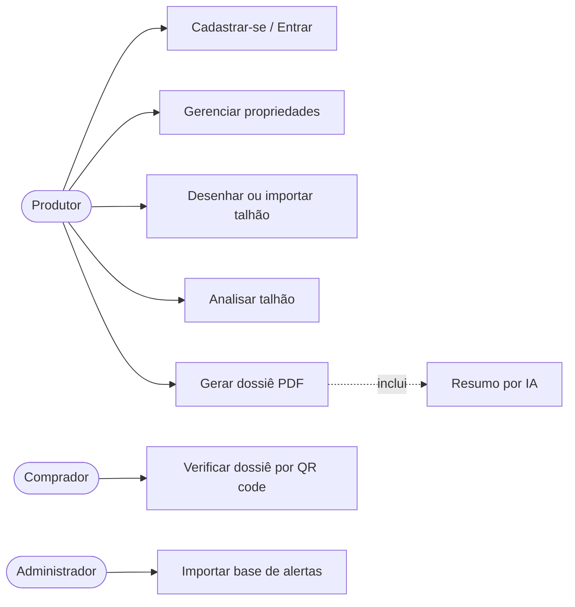

# 3. Especificação de Requisitos de Software (SRS) — RastroVerde

Baseada na estrutura da IEEE 830 / ISO/IEC/IEEE 29148, simplificada.

| Item | Valor |
|---|---|
| Versão | 1.0 — 04/11/2026 |
| Autores | Luiza Coelho, Lucas |

## 1. Introdução

### 1.1 Propósito
Este documento descreve os requisitos funcionais e não funcionais do MVP do RastroVerde, sistema
web de checagem de desmatamento pós-2020 e geração de dossiê de conformidade com o EUDR.

### 1.2 Escopo
Conforme a seção 6 do [Documento de Visão](01-visao.md#6-escopo-do-mvp). Itens fora do escopo não
geram requisitos nesta versão.

### 1.3 Definições

| Termo | Definição |
|---|---|
| EUDR | Regulamento (UE) 2023/1115 sobre produtos livres de desmatamento |
| Talhão | Área contínua de cultivo, representada por um polígono |
| Alerta | Polígono de desmatamento detectado, com data de detecção (MapBiomas Alerta / PRODES) |
| Data de corte | 31/12/2020 — desmatamento após essa data torna o produto não conforme |
| Dossiê | Documento PDF com o resultado da análise e código de verificação |
| GeoJSON | Formato aberto (RFC 7946) para geometrias geográficas |
| CAR | Cadastro Ambiental Rural |

## 2. Descrição geral

### 2.1 Perspectiva do produto
Aplicação web independente, acessada por navegador, com banco de dados próprio e uma base de
alertas de desmatamento importada previamente. Usa um serviço externo de IA (Google Gemini) só para
redigir o resumo do dossiê.

### 2.2 Atores

| Ator | Descrição |
|---|---|
| Produtor | Usuário autenticado; dono das propriedades |
| Comprador | Usuário anônimo que acessa a página de verificação |
| Administrador | Equipe; importa a base de alertas por script |
| Gemini (sistema externo) | Gera o texto do resumo |

### 2.3 Restrições
- Plataforma web responsiva (desktop e celular), navegadores Chrome, Edge e Firefox atuais.
- Somente serviços com plano gratuito.
- Geometrias em WGS 84 (EPSG:4326).

## 3. Requisitos funcionais

| ID | Requisito | Prior. | História |
|---|---|---|---|
| RF01 | O sistema deve permitir cadastro de usuário com nome, e-mail e senha (mín. 8 caracteres). | Alta | US01 |
| RF02 | O sistema deve autenticar o usuário por e-mail e senha e permitir logout. | Alta | US02 |
| RF03 | O sistema deve permitir criar, listar, editar e excluir propriedades (nome, município, UF, cultura, nº CAR opcional). | Alta | US03 |
| RF04 | O sistema deve permitir desenhar um talhão como polígono em um mapa interativo. | Alta | US04 |
| RF05 | O sistema deve validar o polígono (fechado, sem auto-interseção, área entre 0,1 ha e 10.000 ha). | Alta | US04 |
| RF06 | O sistema deve calcular e exibir a área do talhão em hectares. | Alta | US04 |
| RF07 | O sistema deve permitir importar um talhão a partir de arquivo GeoJSON (Polygon/MultiPolygon, até 1 MB). | Média | US05 |
| RF08 | O sistema deve permitir listar, editar e excluir talhões de uma propriedade. | Alta | US06 |
| RF09 | O sistema deve calcular a interseção entre o talhão e os alertas com data de detecção posterior a 31/12/2020. | Alta | US07 |
| RF10 | O sistema deve classificar o risco: **Baixo** (sem sobreposição), **Atenção** (< 1% da área e < 0,5 ha), **Alto** (demais casos). | Alta | US08 |
| RF11 | O sistema deve registrar cada análise com data/hora, versão da base, área sobreposta (ha e %) e risco. | Alta | US07 |
| RF12 | O sistema deve exibir no mapa o talhão e as áreas sobrepostas destacadas. | Alta | US08 |
| RF13 | O sistema deve listar o histórico de análises de cada talhão. | Média | US09 |
| RF14 | O sistema deve gerar um dossiê em PDF a partir de uma análise concluída. | Alta | US10 |
| RF15 | O dossiê deve conter: dados da propriedade e do talhão, coordenadas do centróide, imagem do mapa, resultado, fonte e versão dos dados, data, código único, QR code e aviso legal. | Alta | US10 |
| RF16 | O sistema deve gerar, via IA, um resumo de até 120 palavras em linguagem simples; se a IA falhar, usar texto padrão. | Média | US11 |
| RF17 | O sistema deve gerar para cada dossiê um código único e um hash SHA-256 do conteúdo. | Alta | US12 |
| RF18 | O sistema deve oferecer a página pública `/verificar/{codigo}` exibindo validade, data, risco e hash, sem exibir dados pessoais. | Alta | US12 |
| RF19 | O sistema deve permitir que o administrador importe a base de alertas a partir de GeoJSON por script de linha de comando. | Média | US13 |
| RF20 | Cada usuário só pode ver e alterar as próprias propriedades, talhões, análises e dossiês. | Alta | — |

## 4. Requisitos não funcionais

| ID | Categoria | Requisito |
|---|---|---|
| RNF01 | Desempenho | A análise de um talhão de até 1.000 ha deve terminar em até 5 s. |
| RNF02 | Desempenho | A geração do PDF deve terminar em até 10 s (incluindo IA). |
| RNF03 | Segurança | Senhas armazenadas com hash bcrypt; sessão via cookie HttpOnly (Auth.js). |
| RNF04 | Segurança | Todo acesso a dados verifica o dono do recurso no servidor (RF20). |
| RNF05 | Segurança | Comunicação somente por HTTPS. Chaves de API só no servidor, em variáveis de ambiente. |
| RNF06 | Privacidade (LGPD) | Coletar apenas nome e e-mail; a página pública não mostra nome nem e-mail do produtor. |
| RNF07 | Usabilidade | Fluxo cadastro de talhão → PDF em no máximo 4 telas; interface em português. |
| RNF08 | Usabilidade | Layout responsivo a partir de 360 px de largura. |
| RNF09 | Acessibilidade | Contraste mínimo WCAG AA; risco indicado por cor **e** texto. |
| RNF10 | Confiabilidade | Falha da IA não impede a geração do dossiê (RF16). |
| RNF11 | Rastreabilidade | Toda análise guarda a versão da base de alertas usada. |
| RNF12 | Manutenibilidade | TypeScript estrito, lint no CI, cobertura de testes ≥ 70% no módulo de análise geoespacial. |
| RNF13 | Portabilidade | Implantação em Vercel + PostgreSQL gerenciado (Supabase), sem servidor próprio. |
| RNF14 | Legal | O dossiê informa que não substitui a declaração de diligência oficial. |

## 5. Regras de negócio

| ID | Regra |
|---|---|
| RN01 | Data de corte EUDR: 31/12/2020. Só contam alertas com data de detecção posterior. |
| RN02 | Um dossiê só pode ser gerado a partir de uma análise concluída. |
| RN03 | Editar o polígono de um talhão invalida as análises anteriores para novos dossiês (o histórico é mantido). |
| RN04 | Dossiês emitidos são imutáveis; o hash garante que o conteúdo não foi alterado. Um talhão com dossiê emitido não pode ser excluído (nem a propriedade dele, que o excluiria em cascata). |
| RN05 | O talhão precisa ter área no município declarado na propriedade (limites do IBGE), senão a análise e a emissão do dossiê são bloqueadas: o dossiê mostra o município ao comprador. O nome é comparado sem acentos nem maiúsculas. *Incluída após o defeito 8 do relatório de testes.* |

### Notas de implementação do dossiê (Sprint 3)
- **RF15 — imagem do mapa:** desenho vetorial do talhão e das sobreposições, com norte e barra de
  escala, gerado no servidor. Não há imagem de satélite nem mapa de fundo (fora do MVP).
- **RF17 — hash:** SHA-256 dos bytes do PDF guardado. O hash não pode estar dentro do próprio
  arquivo; ele aparece na página de verificação, que também confere um PDF enviado pelo comprador
  calculando o hash no navegador.
- **RF18 — página pública:** mostra código, data de emissão, cultura e município, risco, áreas,
  base, data da análise e hash. Não mostra nome do produtor, e-mail nem nome da propriedade (RNF06).
  Os dados vêm de uma cópia guardada na emissão, então editar a propriedade depois não altera o
  que o comprador vê (RN04).

## 6. Casos de uso principais

### UC4 — Analisar talhão
1. Produtor abre o talhão e clica em "Analisar".
2. Sistema busca alertas cujo retângulo envolvente cruza o do talhão.
3. Sistema calcula a interseção exata e soma a área (RF09).
4. Sistema classifica o risco (RF10), salva a análise (RF11) e exibe o mapa (RF12).
- **Exceção:** base de alertas não cobre a região → aviso "região sem dados" e risco não calculado.
  Cada base guarda a área de cobertura do recorte (ex.: limites dos municípios); usa-se a base mais
  recente que cobre o talhão inteiro (tolerância de 0,1% da área para arredondamento de bordas).
  O aviso diz o que as bases cobrem (ex.: "Luís Eduardo Magalhães e São Desidério (BA)"), e o
  editor de talhão mostra a área coberta em azul tracejado.
- Sobreposições menores que 1 m² são tratadas como ruído numérico (alerta que só encosta na borda).

## 7. Matriz de rastreabilidade (resumo)

| História | Requisitos |
|---|---|
| US01–US02 | RF01, RF02, RNF03 |
| US03, US06 | RF03, RF08, RF20 |
| US04–US05 | RF04–RF07 |
| US07–US09 | RF09–RF13, RNF01, RNF11 |
| US10–US11 | RF14–RF16, RNF02, RNF10, RNF14 |
| US12 | RF17, RF18, RNF06 |
| US13 | RF19 |
