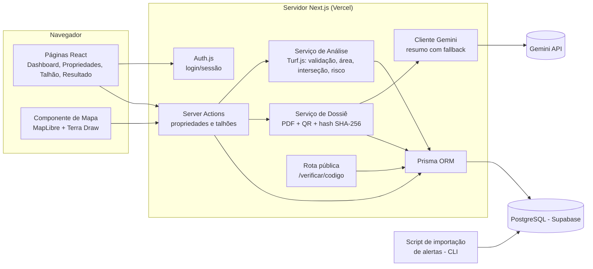
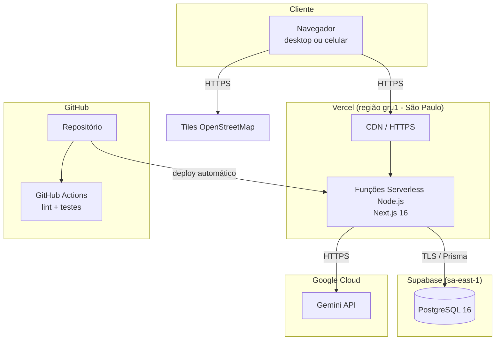
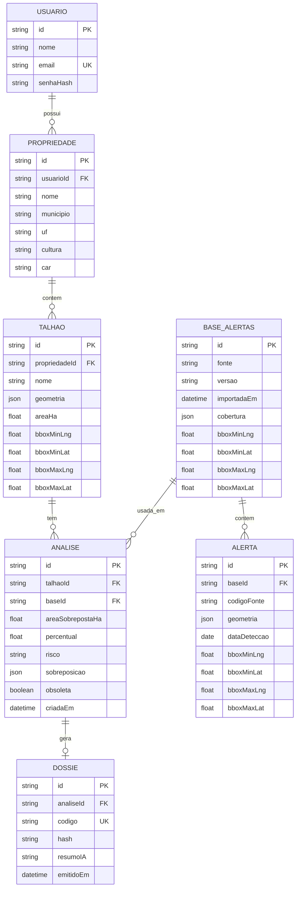
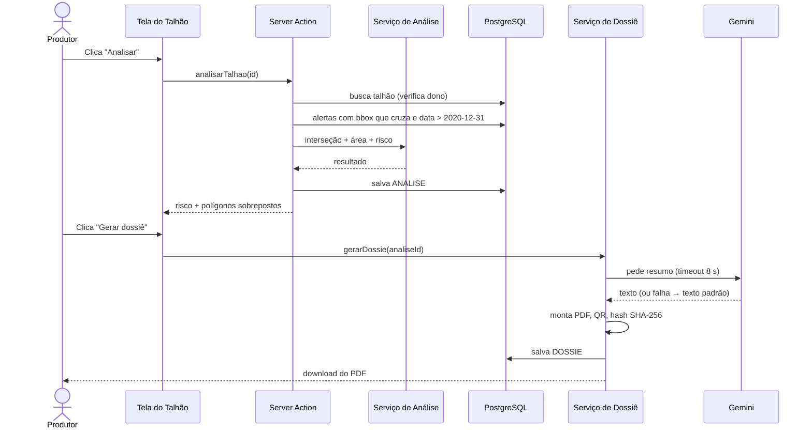

# 4. Arquitetura do Sistema — RastroVerde

Diagramas em Mermaid (renderizam direto no GitHub). Estilo inspirado no modelo **C4**.

## 4.1 Tecnologias

| Camada | Tecnologia | Por quê |
|---|---|---|
| Front-end + back-end | **Next.js 16** (App Router, Server Actions), TypeScript | Um projeto só, deploy simples na Vercel |
| UI | Tailwind CSS | Rapidez para montar telas |
| Mapa | **MapLibre GL JS** + **Terra Draw** | Mapas vetoriais open source; desenho de polígonos |
| Análise geoespacial | **Turf.js** | Interseção e área de polígonos em TypeScript, sem servidor GIS |
| Banco de dados | **PostgreSQL (Supabase)** + Prisma ORM | Plano gratuito, Postgres gerenciado com pooler; geometria guardada como GeoJSON (JSONB) + bbox indexado |
| Autenticação | Auth.js (credenciais, JWT) | Padrão do ecossistema Next |
| IA | **Google Gemini** (API) | Resumo em linguagem simples; plano gratuito |
| PDF e QR | `@react-pdf/renderer`, `qrcode` | PDF gerado no servidor |
| Dados de referência | Recorte GeoJSON de **MapBiomas Alerta / PRODES** | Bases públicas oficiais de desmatamento |
| Qualidade | ESLint, Vitest, Playwright, GitHub Actions | Lint + testes no CI |
| Hospedagem | Vercel | Plano gratuito, HTTPS automático |

### Decisões de arquitetura (ADRs resumidos)

- **ADR-01 — Turf.js em vez de PostGIS no MVP.** A base de alertas é um recorte pequeno; filtrar por
  bbox no banco e calcular a interseção com Turf.js no servidor é suficiente e evita configurar
  extensões. *Evolução:* migrar para PostGIS se a base crescer.
- **ADR-02 — Monólito Next.js.** Duas pessoas e 4 semanas: um único deploy reduz complexidade.
- **ADR-03 — Base de alertas estática e versionada.** Importada por script (RF19); cada análise
  registra a versão (RNF11). Elimina dependência de APIs externas instáveis.
- **ADR-04 — IA opcional.** O resumo por IA nunca bloqueia o PDF (RNF10).
- **ADR-05 — Supabase como PostgreSQL gerenciado.** Substitui o Neon (decisão da PO, 04/11/2026).
  Usado só como banco Postgres via Prisma: a aplicação conecta pelo *pooler* (`DATABASE_URL`,
  modo *transaction*, porta 6543) e as migrações usam o pooler em modo *session* (`DIRECT_URL`,
  porta 5432; a conexão direta do plano gratuito é só IPv6). Autenticação
  continua no Auth.js; Supabase Auth, Storage e o SDK `supabase-js` não são usados no MVP.
  Como o schema `public` é exposto pela Data API do Supabase, a migração inicial ativa RLS sem
  políticas em todas as tabelas (nega o acesso pela API; o Prisma conecta como dono e não é afetado).
- **ADR-06 — Next.js sem Cache Components.** O `create-next-app` 16 liga `cacheComponents`; no MVP
  ele fica desligado porque todas as telas dependem da sessão do usuário. Usamos renderização
  dinâmica e a checagem otimista de sessão no `src/proxy.ts` (antigo middleware).

## 4.2 Diagrama de contexto

## 4.3 Diagrama de componentes

## 4.4 Diagrama de implantação

## 4.5 Modelo de dados

Notas de implementação (`prisma/schema.prisma`):
- O retângulo envolvente (bbox) fica em 4 colunas numéricas indexadas, para o filtro prévio
  da análise ser uma consulta simples (ADR-01).
- `ANALISE.obsoleta` implementa a RN03: editar o polígono marca as análises anteriores como
  obsoletas (o histórico é mantido).
- `PROPRIEDADE` também guarda `criadoEm`/`alteradoEm`; `USUARIO`, `criadoEm`.
- `BASE_ALERTAS.cobertura` é a área do recorte (limites dos municípios). Talhão fora dela →
  "região sem dados" (UC4). A análise usa a base mais recente que cobre o talhão.
- `ANALISE.sobreposicao` guarda um FeatureCollection com a interseção de cada alerta (código, data
  de detecção, área); a área total é a da união delas, para não contar alertas sobrepostos duas vezes.

Fluxo da importação (US13): `scripts/importar-alertas.ts` → `src/lib/alertas/importacao.ts`
(validação) → banco. Fluxo da análise: `src/lib/dados/analises.ts` (bases e alertas com bbox que
cruza o do talhão) → `src/lib/geo/analise.ts` (Turf.js, código puro e testado) → `ANALISE`.

## 4.6 Sequência — análise e dossiê

## 4.7 Coerência com os requisitos

| Requisito | Componente responsável |
|---|---|
| RF01–RF02, RNF03 | Auth.js |
| RF03–RF08, RF20 | Server Actions + Componente de Mapa |
| RF09–RF13, RNF01, RNF11 | Serviço de Análise (Turf.js) + BASE_ALERTAS versionada |
| RF14–RF17, RNF10 | Serviço de Dossiê + Cliente Gemini com fallback |
| RF18, RNF06 | Rota pública `/verificar` (só dados não pessoais) |
| RF19 | Script de importação |
| RNF05, RNF13 | Vercel (HTTPS) + Supabase |
