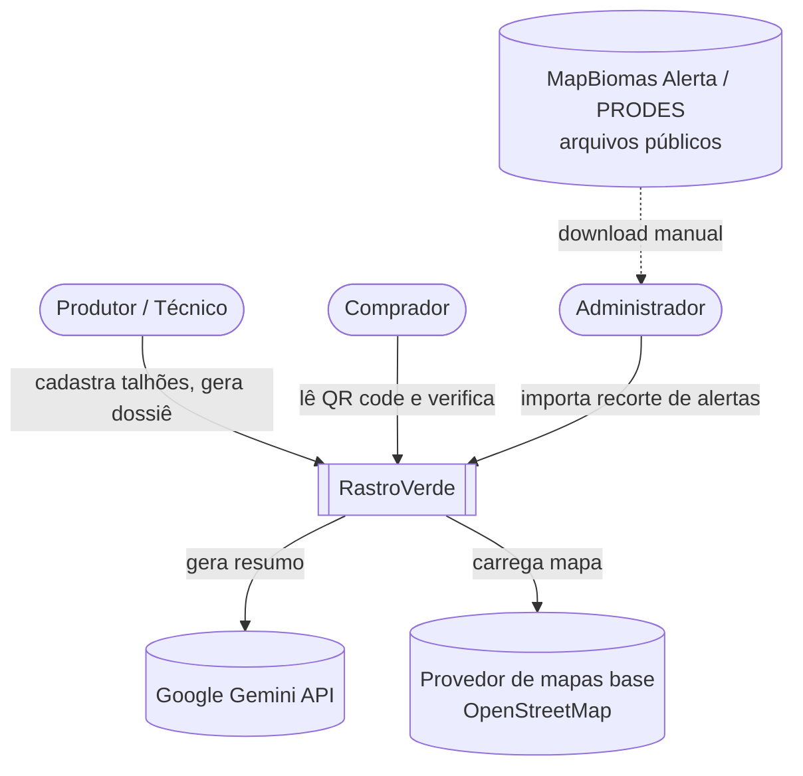
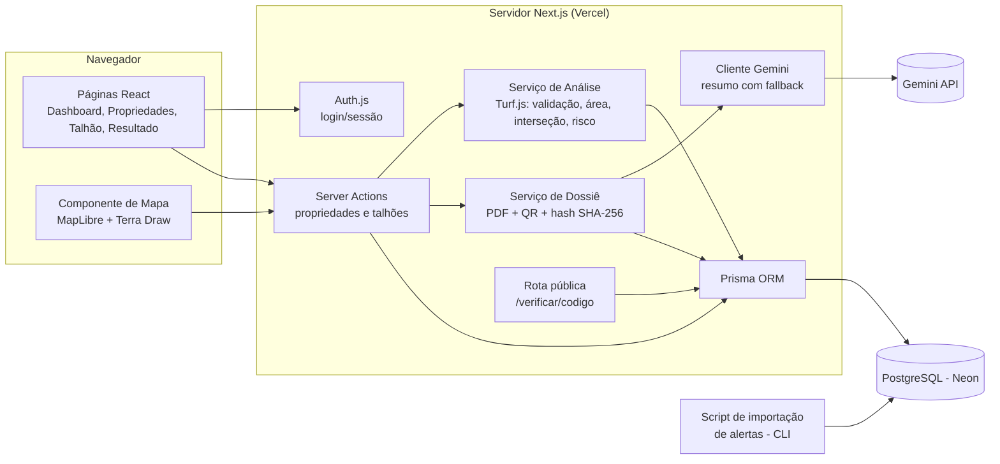
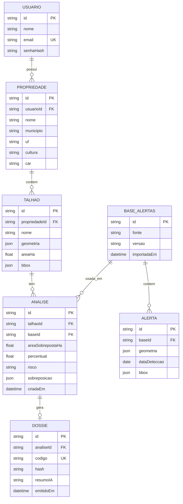
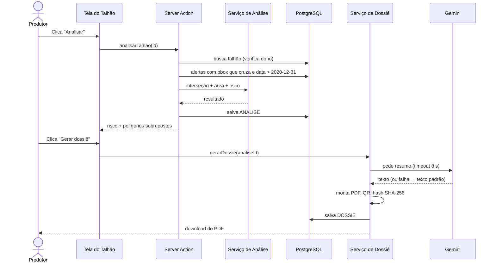

# 4. Arquitetura do Sistema — RastroVerde

Diagramas em Mermaid (renderizam direto no GitHub). Estilo inspirado no modelo **C4**.

## 4.1 Tecnologias

| Camada | Tecnologia | Por quê |
|---|---|---|
| Front-end + back-end | **Next.js 16** (App Router, Server Actions), TypeScript | Um projeto só, deploy simples na Vercel |
| UI | Tailwind CSS | Rapidez para montar telas |
| Mapa | **MapLibre GL JS** + **Terra Draw** | Mapas vetoriais open source; desenho de polígonos |
| Análise geoespacial | **Turf.js** | Interseção e área de polígonos em TypeScript, sem servidor GIS |
| Banco de dados | **PostgreSQL (Neon)** + Prisma ORM | Gratuito, serverless; geometria guardada como GeoJSON (JSONB) + bbox indexado |
| Autenticação | Auth.js (credenciais, JWT) | Padrão do ecossistema Next |
| IA | **Google Gemini** (API) | Resumo em linguagem simples; plano gratuito |
| PDF e QR | `@react-pdf/renderer`, `qrcode` | PDF gerado no servidor |
| Dados de referência | Recorte GeoJSON de **MapBiomas Alerta / PRODES** | Bases públicas oficiais de desmatamento |
| Qualidade | ESLint, Vitest, Playwright, GitHub Actions | Lint + testes no CI |
| Hospedagem | Vercel | Plano gratuito, HTTPS automático |

### Decisões de arquitetura (ADRs resumidos)

- **ADR-01 — Turf.js em vez de PostGIS no MVP.** A base de alertas é um recorte pequeno; filtrar por
  bbox no banco e calcular a interseção com Turf.js no servidor é suficiente e evita configurar
  extensões. *Evolução:* migrar para PostGIS se a base crescer.
- **ADR-02 — Monólito Next.js.** Duas pessoas e 4 semanas: um único deploy reduz complexidade.
- **ADR-03 — Base de alertas estática e versionada.** Importada por script (RF19); cada análise
  registra a versão (RNF11). Elimina dependência de APIs externas instáveis.
- **ADR-04 — IA opcional.** O resumo por IA nunca bloqueia o PDF (RNF10).

## 4.2 Diagrama de contexto

## 4.3 Diagrama de componentes

## 4.4 Diagrama de implantação

## 4.5 Modelo de dados

## 4.6 Sequência — análise e dossiê

## 4.7 Coerência com os requisitos

| Requisito | Componente responsável |
|---|---|
| RF01–RF02, RNF03 | Auth.js |
| RF03–RF08, RF20 | Server Actions + Componente de Mapa |
| RF09–RF13, RNF01, RNF11 | Serviço de Análise (Turf.js) + BASE_ALERTAS versionada |
| RF14–RF17, RNF10 | Serviço de Dossiê + Cliente Gemini com fallback |
| RF18, RNF06 | Rota pública `/verificar` (só dados não pessoais) |
| RF19 | Script de importação |
| RNF05, RNF13 | Vercel (HTTPS) + Neon |
