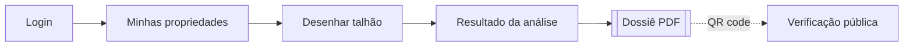
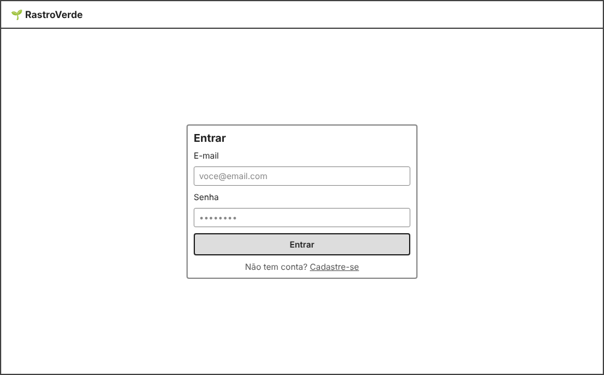
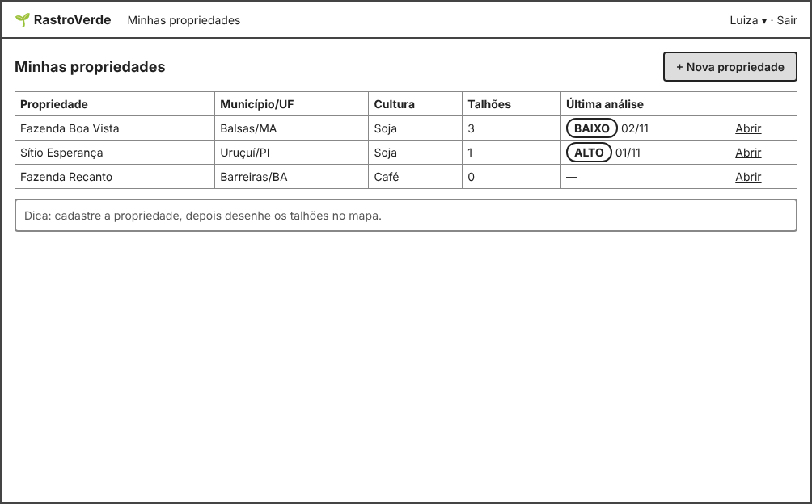
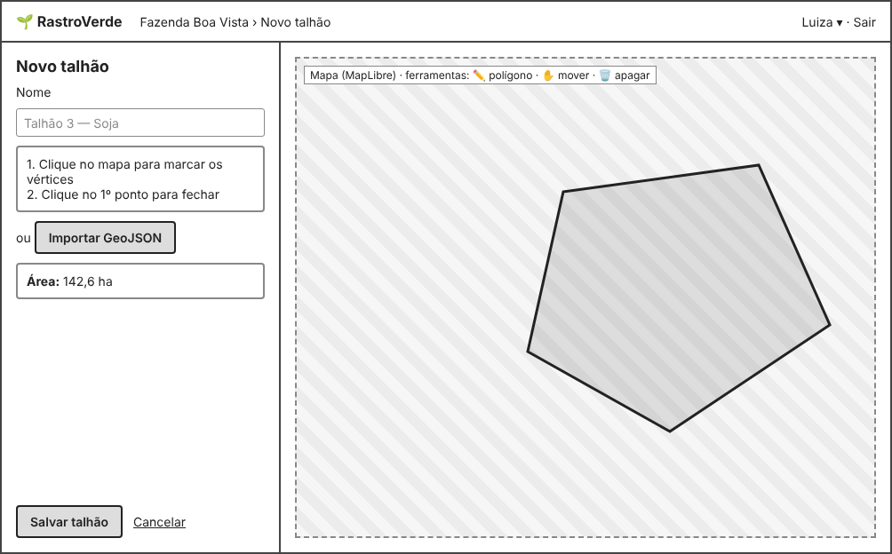
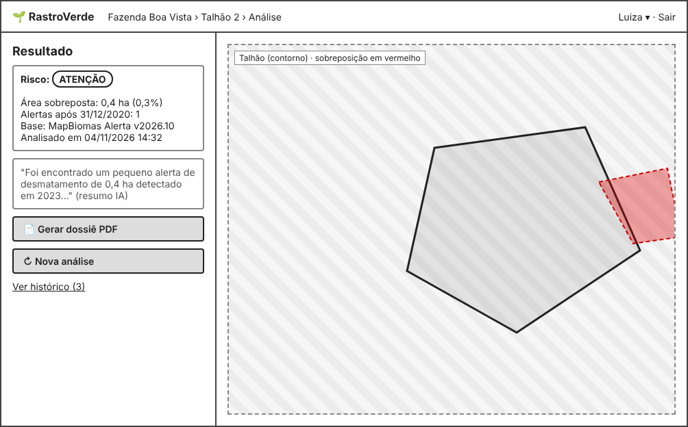
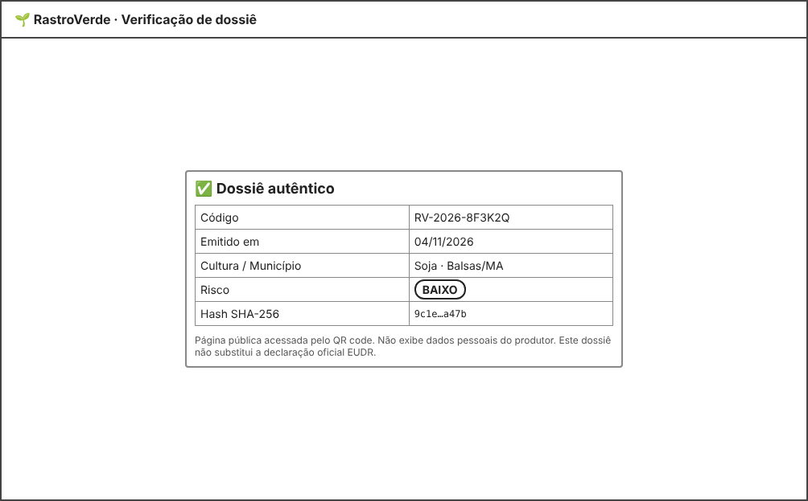

# 5. Protótipo de Interface (Wireframes) — RastroVerde

Wireframes de baixa fidelidade das telas principais. Fonte editável: [wireframes/wireframes.html](wireframes/wireframes.html).

Fluxo principal (RNF07 — até 4 telas): **Propriedades → Desenhar talhão → Resultado → PDF**.

## Tela 1 — Login (RF01, RF02)

## Tela 2 — Minhas propriedades (RF03, RF13)
Lista com o risco da última análise (cor **e** texto, RNF09).

## Tela 3 — Desenhar talhão (RF04–RF07)
Desenho no mapa ou importação de GeoJSON; área calculada em tempo real.

## Tela 4 — Resultado da análise (RF09–RF12, RF14, RF16)
Risco, área sobreposta em vermelho, resumo por IA e botão para gerar o dossiê.

## Tela 5 — Verificação pública (RF17, RF18, RNF06)
Aberta pelo QR code, sem login e sem dados pessoais.

## Usabilidade básica
- Navegação por trilha (breadcrumb) no topo.
- Ação principal de cada tela em um botão destacado.
- Instruções curtas na própria tela de desenho.
- Textos em português simples; termos técnicos explicados no resumo.
