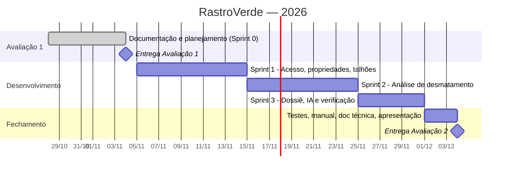

# 6. Plano de Projeto Inicial — RastroVerde

## 6.1 Equipe e papéis

| Integrante | Papel Scrum | Responsabilidades |
|---|---|---|
| Professor | Product Owner | Prioriza o backlog, aceita os incrementos nas Reviews |
| Luiza Coelho | Scrum Master + Dev | Facilita as cerimônias, remove impedimentos; back-end, análise geoespacial, PDF, deploy |
| Lucas | Dev | Front-end (telas e mapa), testes E2E, manual do usuário |

> Papéis provisórios. Se a equipe ficar com 1 pessoa, o plano mantém só as histórias **Must**.

## 6.2 Cerimônias (Scrum adaptado)

| Cerimônia | Quando | Duração |
|---|---|---|
| Sprint Planning | 1º dia de cada sprint | 1 h |
| Daily | Assíncrona, mensagem no grupo (feito / vou fazer / impedimento) | 5 min |
| Sprint Review | Último dia da sprint, com demonstração | 30 min |
| Retrospectiva | Logo após a Review | 20 min |

Ferramentas: **GitHub Projects** (quadro Kanban: Backlog → A fazer → Fazendo → Revisão → Pronto),
GitHub Issues para histórias, Pull Requests com revisão cruzada.

## 6.3 Cronograma macro

| Sprint | Período | Meta | Histórias | Pts |
|---|---|---|---|---|
| 0 | até 04/11 | Documentação da Avaliação 1, repositório criado | — | — |
| 1 | 05/11 – 14/11 | Usuário entra, cadastra propriedade e desenha talhão | US01, US02, US03, US04, US06 | 19 |
| 2 | 15/11 – 24/11 | Talhão analisado com risco no mapa | US05, US07, US08, US13 | 19 |
| 3 | 25/11 – 30/11 | Dossiê PDF verificável por QR code | US09, US10, US11, US12 | 12 |
| Fechamento | 01/12 – 04/12 | Plano/relatório de testes, manual, doc técnica, ensaio da apresentação | — | — |

## 6.4 Divisão de tarefas

| Tarefa | Responsável | Sprint |
|---|---|---|
| Setup do projeto (Next.js, Prisma, Neon, Vercel, CI) | Luiza | 1 |
| Autenticação (US01, US02) | Luiza | 1 |
| CRUD de propriedades — telas (US03) | Lucas | 1 |
| Componente de mapa com desenho (US04) | Lucas | 1 |
| Validação e área do polígono — servidor (US04, US06) | Luiza | 1 |
| Script de importação da base de alertas (US13) | Luiza | 2 |
| Serviço de análise com Turf.js + testes unitários (US07) | Luiza | 2 |
| Tela de resultado com sobreposição no mapa (US08) | Lucas | 2 |
| Importação de GeoJSON (US05) | Lucas | 2 |
| Geração de PDF, QR code e hash (US10) | Luiza | 3 |
| Integração Gemini com fallback (US11) | Luiza | 3 |
| Página pública de verificação + histórico (US12, US09) | Lucas | 3 |
| Testes E2E (Playwright) e relatório de testes | Lucas | Fech. |
| Manual do usuário | Lucas | Fech. |
| Documentação técnica e slides | Luiza | Fech. |

## 6.5 Preparação para o Trabalho 2

- [x] Repositório no GitHub com a documentação.
- [ ] Criar o quadro no GitHub Projects com as histórias US01–US13.
- [ ] Baixar o recorte de alertas (1–2 municípios produtores de soja no MATOPIBA) em GeoJSON.
- [ ] Criar contas gratuitas: Vercel, Neon, Google AI Studio (Gemini).
- [ ] Confirmar a entrada do Lucas e ajustar a divisão de tarefas.

## 6.6 Gestão de escopo

O escopo do MVP é o da [seção 6 da Visão](01-visao.md#6-escopo-do-mvp). Pedidos novos entram no
backlog como "pós-MVP"; só entram em sprint com aprovação do PO e se couberem na capacidade.
Se uma sprint atrasar, cortam-se primeiro os itens **Should** (US05, US09, US11, US13 — este último
vira importação manual).
