# 8. Manual do Usuário — RastroVerde

Endereço: **https://rastroverde.vercel.app**. Funciona no navegador do computador ou do celular;
não precisa instalar nada.

## Para que serve

A União Europeia só compra soja, café, cacau e outros produtos de áreas **sem desmatamento depois
de 31/12/2020**. É a regra do EUDR, o regulamento europeu contra o desmatamento. O RastroVerde
confere a sua área nos mapas públicos de desmatamento do governo (PRODES, do INPE) e gera um
**dossiê em PDF** que o comprador pode conferir pelo **QR code**.

> **Importante:** o dossiê ajuda a mostrar que a área não tem desmatamento depois de 2020, mas
> **não substitui** a declaração oficial que o exportador entrega à União Europeia. Ele também não
> avalia outros requisitos, como a regularidade da produção.

**Onde funciona hoje:** a base de desmatamento carregada cobre **Luís Eduardo Magalhães e São
Desidério (BA)**. Áreas em outros municípios ainda ficam sem análise (veja a seção 5).

O caminho é curto:

**Criar conta → Cadastrar a propriedade → Desenhar o talhão → Analisar → Gerar o dossiê → Enviar ao comprador**

---

## 1. Criar a conta e entrar

1. Abra o endereço e clique em **Criar conta**.
2. Preencha nome, e-mail e uma senha de **pelo menos 8 caracteres**.
3. Nas próximas vezes, use **Entrar** com o mesmo e-mail e senha. Para sair, clique em **Sair**
   no canto de cima.

| Criar conta | Entrar |
|---|---|
| 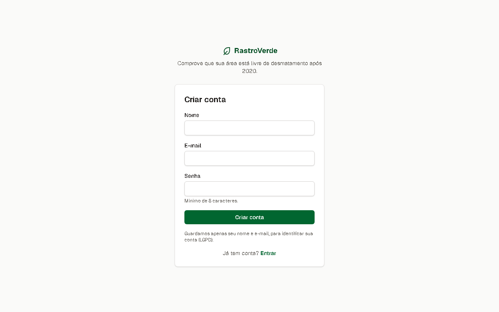 | 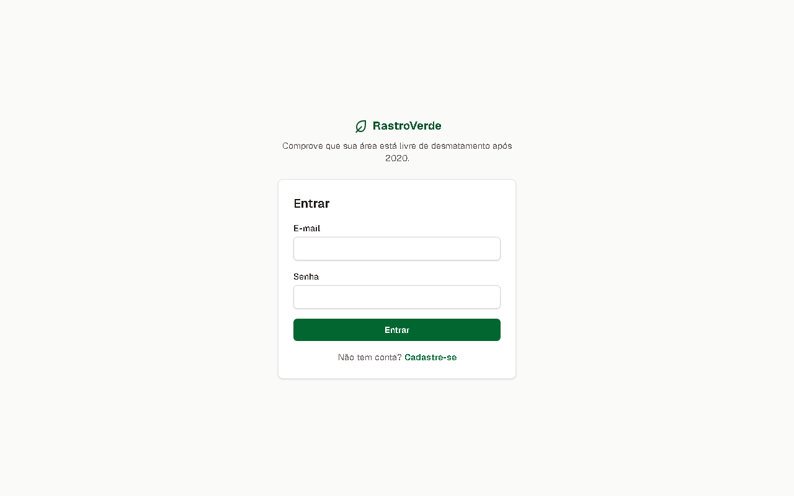 |

O RastroVerde só guarda seu nome e seu e-mail, e eles **nunca** aparecem para o comprador.

## 2. Cadastrar a propriedade

1. Em **Minhas propriedades**, clique em **+ Nova propriedade**.
2. Informe o nome da fazenda, o município, o estado (UF) e a cultura.
3. O número do **CAR** é opcional. Se tiver, copie como está no recibo.
4. Clique em **Cadastrar**.

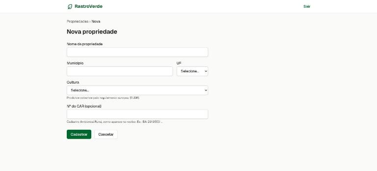

## 3. Desenhar ou importar o talhão

Talhão é a área plantada. Cada talhão é desenhado como um polígono no mapa.

Na página da propriedade, clique em **+ Desenhar talhão**.

**Para desenhar:**

1. Aproxime o mapa da sua área com o **+** ou a rodinha do mouse.
2. **Clique em cada canto** do talhão. A área aparece embaixo, enquanto você desenha.
3. Para fechar, **clique no primeiro ponto** ou **dê dois cliques**.
4. Errou um ponto? Use **Desfazer último ponto**. Quer começar de novo? Aperte **Esc**.
5. Depois de fechado, dá para **arrastar os vértices** para ajustar.
6. Dê um nome ao talhão (ex.: "Talhão 1 — Soja 25/26") e clique em **Salvar talhão**.

**Já tem o desenho em arquivo?** Clique em **Importar GeoJSON** e escolha o arquivo. Ele precisa
ter **um único polígono**, em coordenadas geográficas (WGS 84), com até 1 MB. O técnico que fez o
mapeamento consegue exportar nesse formato pelo QGIS.

**A linha azul tracejada** mostra a área onde existe base de desmatamento. Clique em
**Ver área coberta** para o mapa ir até ela.

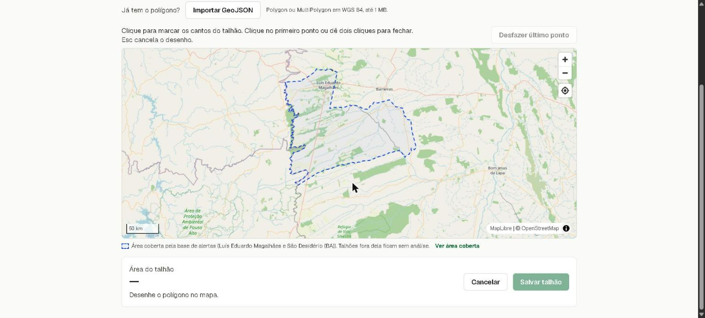

O sistema recusa desenhos com linhas que se cruzam e áreas menores que 0,1 ha ou maiores que
10.000 ha, sempre explicando o motivo.

## 4. Analisar o talhão

Na lista de talhões, clique em **Analisar** e depois em **Analisar talhão**. Em poucos segundos
aparece o resultado:

| Resultado | O que quer dizer |
|---|---|
| ✓ **Risco baixo** | Nenhum desmatamento detectado depois de 31/12/2020 dentro do talhão. |
| ! **Risco atenção** | Há uma sobreposição pequena (menos de 1% da área **e** menos de 0,5 ha). Confira no mapa se é desmatamento de verdade ou só a borda do desenho antes de exportar. |
| ✕ **Risco alto** | Há desmatamento depois de 31/12/2020 dentro do talhão. Sem uma justificativa documentada, o produto dessa área não cumpre a regra europeia. |

Quando houver desmatamento, a área aparece **em vermelho** no mapa, e a tabela mostra cada alerta
com a data em que foi detectado e quantos hectares caem dentro do talhão.

| Risco alto (desmatamento em vermelho) | Risco baixo |
|---|---|
| 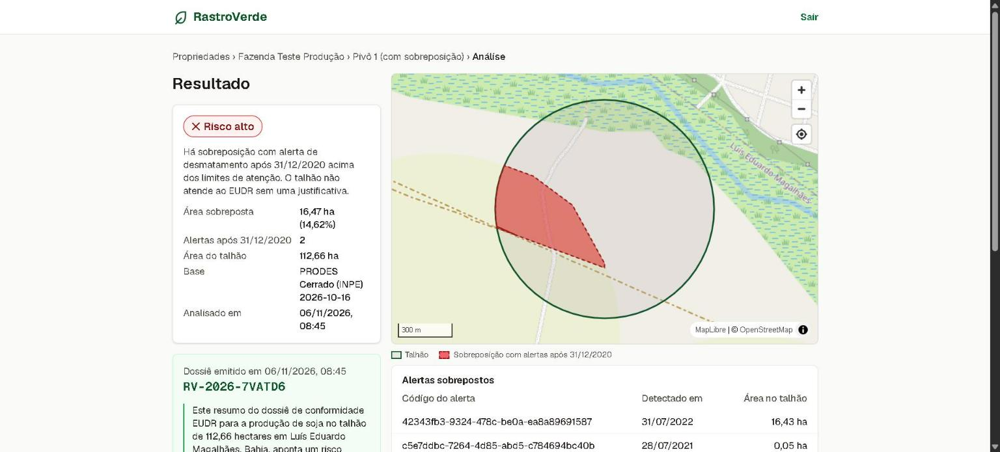 | 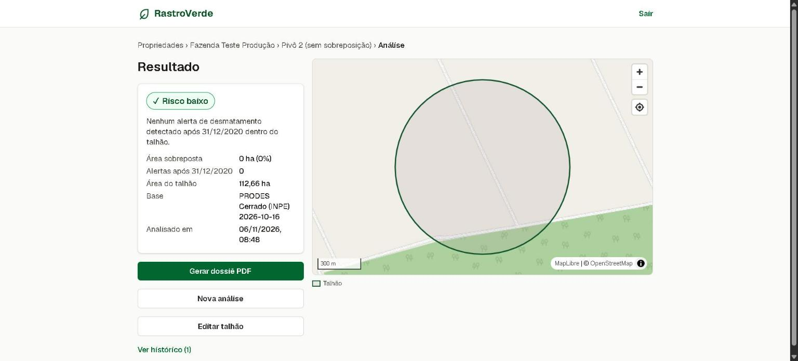 |

O risco também aparece na lista de propriedades. Quando a propriedade tem vários talhões, vale o
do talhão mais crítico.

## 5. "Região sem dados"

Se o talhão estiver fora da área coberta pela base, o sistema **não calcula o risco** e avisa, por
exemplo: *"A base atual cobre Luís Eduardo Magalhães e São Desidério (BA)."* Abra **Editar
talhão** e clique em **Ver área coberta** para ver no mapa onde a análise funciona. Novas regiões
dependem da equipe carregar a base de desmatamento delas.

## 6. Gerar o dossiê em PDF

Na tela do resultado, clique em **Gerar dossiê PDF**. Em alguns segundos aparece o quadro do dossiê,
com:

- o **código** do dossiê (ex.: `RV-2026-7VATD6`);
- um **resumo em linguagem simples**, redigido por inteligência artificial (Google Gemini) a partir
  dos números da análise. Se a IA estiver fora do ar, entra um texto padrão, e o dossiê sai do
  mesmo jeito;
- os botões **Baixar dossiê PDF** e **Abrir página de verificação**.

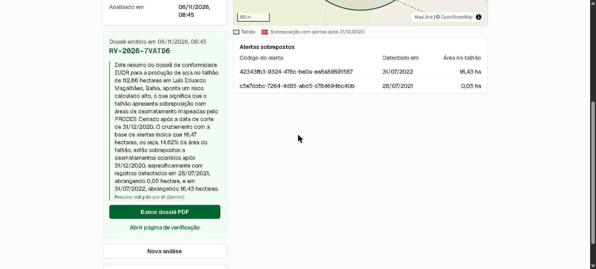

O PDF tem uma página com:
- os dados da propriedade e do talhão, com a coordenada do centro;
- o mapa com a sobreposição;
- o resultado e a lista de alertas;
- a fonte e a versão dos dados e a data;
- o QR code e o aviso legal.

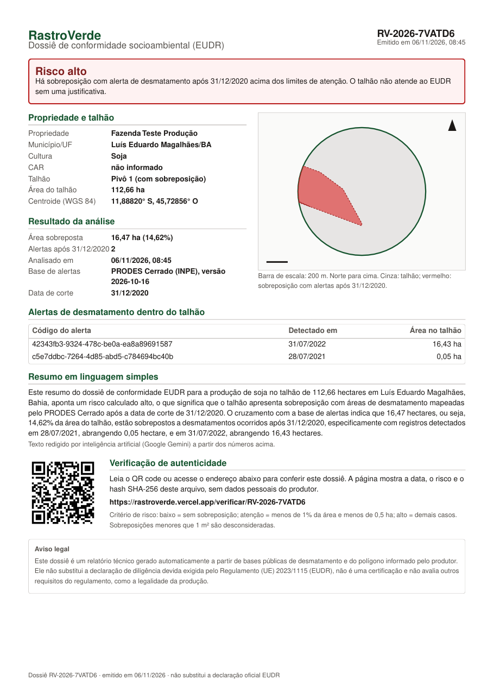

*Dossiê `RV-2026-7VATD6`, emitido em produção para um talhão de teste ([PDF original](evidencias/producao/dossie-RV-2026-7VATD6.pdf)).*

Cada análise gera **um** dossiê. Para um dossiê novo, por exemplo depois de mudar o desenho, faça uma nova análise.

## 7. Enviar ao comprador

1. Clique em **Baixar dossiê PDF**.
2. Envie o arquivo como preferir (e-mail, WhatsApp…).
3. **Não edite o PDF.** Qualquer alteração, mesmo pequena, faz a conferência do comprador acusar
   que o arquivo não é o original.

## 8. Como o comprador confere o dossiê

O comprador **não precisa de conta**:

1. Aponta a câmera do celular para o **QR code** do PDF, ou digita o código em
   `rastroverde.vercel.app/verificar`.
2. Abre a página **"Dossiê autêntico"**, com a data, a cultura e o município, o risco, as áreas, a
   base usada e o **código de segurança (hash)** do arquivo. Seu nome, seu e-mail e o nome da
   fazenda não aparecem.
3. Se quiser, usa **Conferir o arquivo PDF recebido** e escolhe o PDF que recebeu. A conferência
   acontece no próprio celular ou computador; o arquivo não é enviado a ninguém.

| No computador | No celular | Arquivo conferido |
|---|---|---|
| 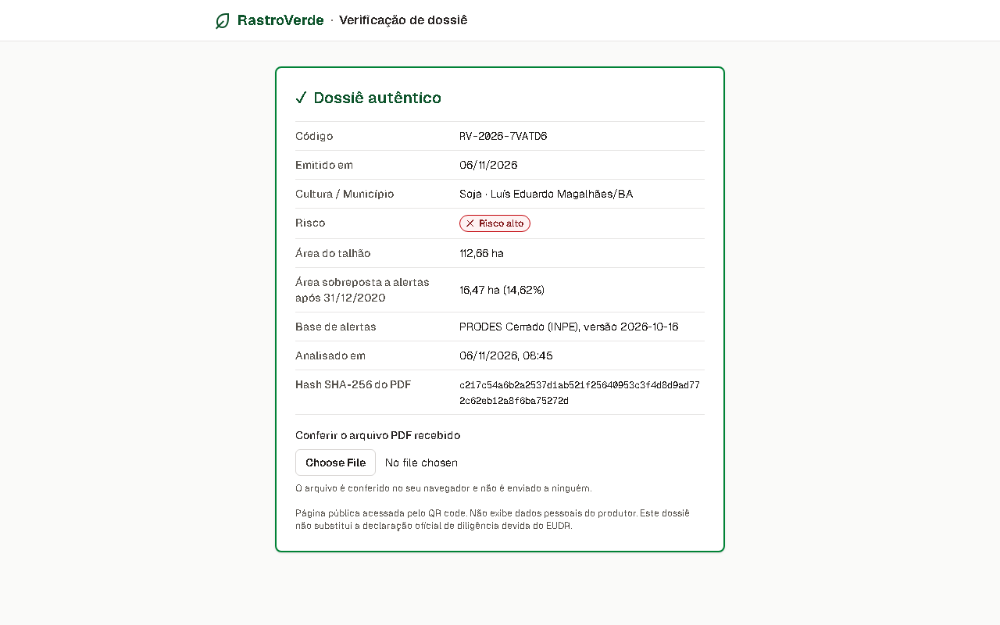 | 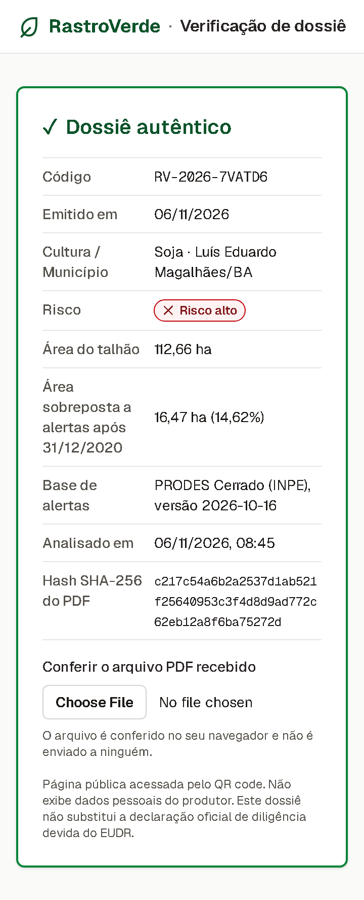 | 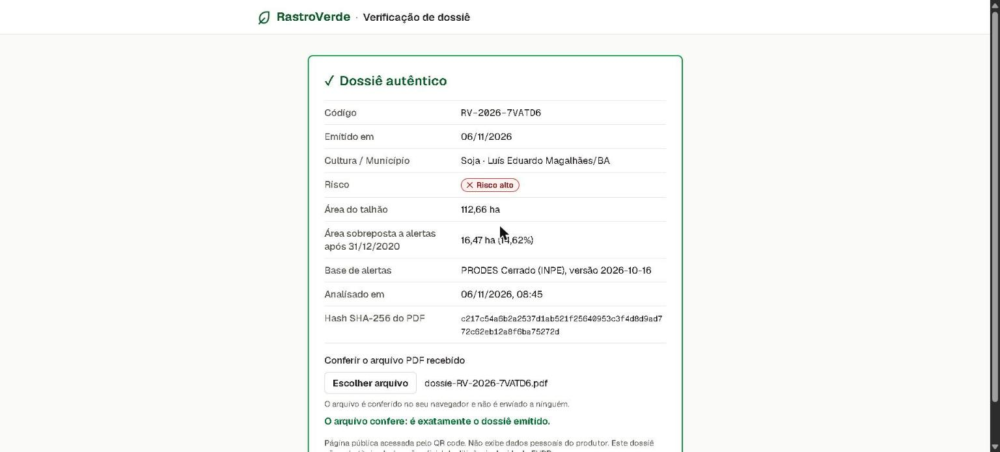 |

Se o código não existir, a página mostra **"Dossiê não encontrado"**: o documento pode não ser
autêntico.

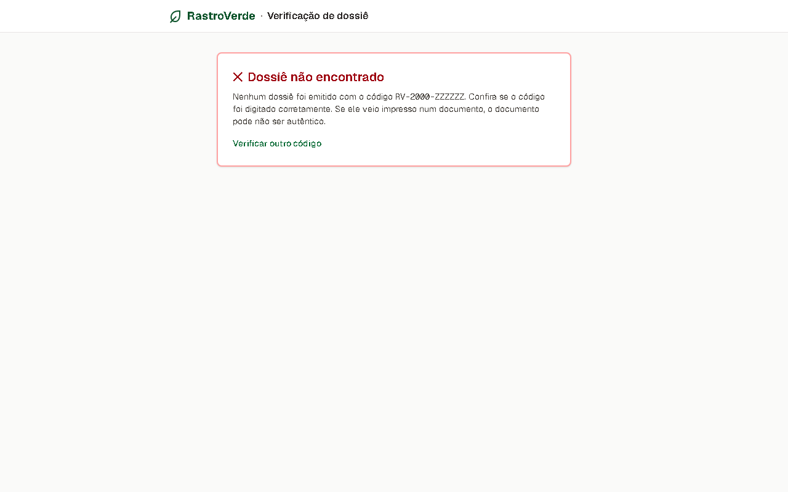

## 9. Histórico, edição e exclusão

- **Histórico:** em **Ver histórico**, cada análise do talhão aparece com data, risco, base e o
  código do dossiê, se houver.

  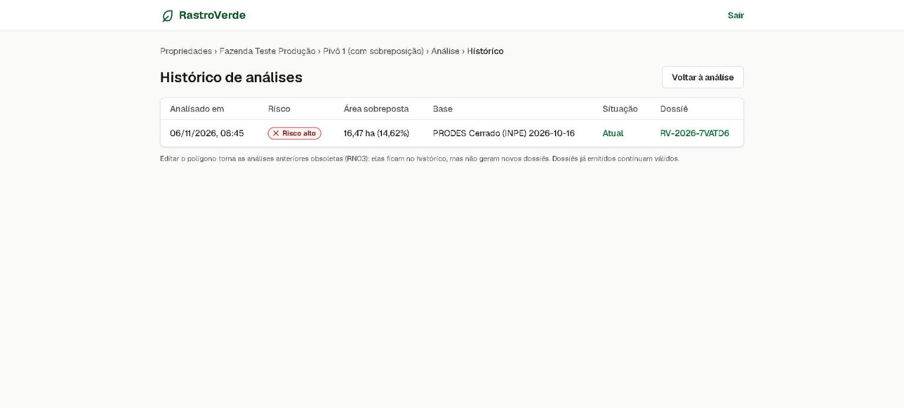

- **Mudou o desenho do talhão?** As análises antigas viram "obsoletas": ficam no histórico, mas
  não geram dossiê novo. Analise de novo. Só trocar o nome não muda nada.
- **Excluir:** um talhão com dossiê emitido **não pode ser excluído**, nem a propriedade dele,
  porque o comprador precisa continuar conseguindo conferir o documento. O botão aparece
  desativado, com o motivo.

## 10. Dúvidas frequentes

**O resultado diz "Risco alto", mas eu não desmatei.** Os alertas vêm do PRODES/INPE, que mapeia
por satélite. Confira no mapa onde fica a área vermelha. Se o desenho do talhão pegou mata vizinha,
ajuste o polígono e analise de novo. Se o desmatamento for anterior ao corte ou tiver
justificativa, guarde a documentação junto com o dossiê.

**Posso usar o dossiê como declaração oficial do EUDR?** Não. Ele é uma evidência técnica para o
comprador; a declaração de diligência é responsabilidade do operador que exporta.

**A IA inventa informações?** A IA recebe só os números da análise, com a instrução de não inventar
dados e de usar no máximo 120 palavras. Mesmo assim, o que vale é o quadro de risco e a tabela de
alertas, que vêm do cálculo, não da IA.
