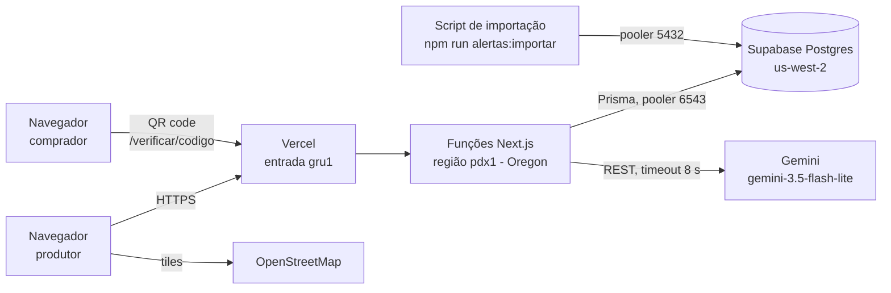

# 9. Documentação Técnica — RastroVerde

| Item | Valor |
|---|---|
| Versão | 1.0 — 06/11/2026 (`main` em `0909469`) |
| Produção | https://rastroverde.vercel.app |
| Repositório | https://github.com/luizacoelh/RastroVerde |

Este documento descreve o sistema **como foi implementado**. A proposta original e os diagramas
completos estão em [04-arquitetura.md](04-arquitetura.md); os requisitos, em [03-srs.md](03-srs.md).

## 1. Visão geral

Monólito Next.js (App Router) que cuida das telas, das Server Actions e das rotas. O banco é o
PostgreSQL do Supabase, acessado pelo Prisma. A análise geoespacial roda no próprio servidor com
Turf.js, contra uma base de alertas de desmatamento importada por script.



Fluxo principal: **talhão → análise → dossiê → verificação**.

1. O produtor desenha ou importa o polígono. O servidor valida de novo: fechado, sem
   auto-interseção, de 0,1 a 10.000 ha.
2. A análise escolhe a base mais recente cuja **cobertura** contém o talhão. Depois busca no banco
   só os alertas posteriores a 31/12/2020 cujo retângulo cruza o do talhão, calcula com Turf a
   interseção exata de cada um e soma a **união** das áreas.
3. O risco é classificado pelo RF10 e a análise é gravada com a versão da base.
4. O dossiê é gerado uma vez: resumo pelo Gemini (ou texto padrão), PDF com mapa e QR code, e hash
   SHA-256. O PDF e uma cópia dos dados ficam gravados.
5. A página pública `/verificar/{codigo}` lê essa cópia e mostra o hash, sem dados pessoais.

## 2. Tecnologias (versões instaladas)

| Camada | Tecnologia |
|---|---|
| Aplicação | Next.js 16.4.5 (App Router, Server Actions, Turbopack), React 19.3, TypeScript 5.9 (estrito) |
| Interface | Tailwind CSS 4.3 |
| Mapa | MapLibre GL 6.16 + Terra Draw 1.39 (desenho), tiles do OpenStreetMap |
| Geoespacial | Turf.js 7.4 (área, interseção, união, kinks, bbox) |
| Banco | PostgreSQL (Supabase) + Prisma 7.10 com `@prisma/adapter-pg` |
| Autenticação | Auth.js (next-auth 5.0.0-beta.32): credenciais, sessão JWT em cookie HttpOnly, senhas com bcryptjs |
| Validação | Zod 4.6 |
| PDF e QR | `@react-pdf/renderer` 4.9 e `qrcode` 1.5.4 (QR desenhado como vetor) |
| IA | Google Gemini pela API REST (`fetch`, sem SDK) |
| Testes | Vitest 5.1 (unitários e cobertura), Playwright 1.64 (E2E) |
| CI e hospedagem | GitHub Actions; Vercel (funções em `pdx1`) |

## 3. Organização do código

```
src/
  app/
    (publico)/        login, cadastro
    (app)/            área logada: propriedades, talhões, análise, histórico
    dossies/[codigo]/pdf/route.ts   download do PDF (só o dono)
    verificar/        página pública de verificação
  components/
    mapa/             base.ts (MapLibre), editor-talhao.tsx (Terra Draw), mapa-leitura.tsx
    ui.tsx            botões, campos, selo de risco
  lib/
    geo/              talhao.ts (validação, área, centroide), analise.ts (interseção e risco), geojson.ts
    alertas/          importacao.ts (validação e reparo da base)
    dossie/           resumo.ts (Gemini e texto padrão), conteudo.ts (código e hash), desenho.ts (mapa e QR), pdf.tsx
    dados/            consultas Prisma, sempre filtrando pelo dono (propriedades, análises, dossiês)
    dal.ts            usuário da sessão; auth.config.ts e proxy.ts fazem a checagem otimista de rota
prisma/               schema.prisma e migrações SQL
scripts/              importar-alertas.ts, prefiltrar-shapefile.mjs, copiar-worker-maplibre.mjs
e2e/                  testes Playwright, base de alertas fictícia em e2e/fixtures/
```

O código "puro" (sem banco nem React) fica em `src/lib/geo`, `src/lib/alertas` e
`src/lib/dossie`. É ali que estão os testes unitários.

## 4. Rotas

| Rota | Acesso | Função |
|---|---|---|
| `/cadastro`, `/login` | Público (logado é redirecionado) | US01, US02 |
| `/propriedades`, `/propriedades/nova`, `/propriedades/[id]`, `/propriedades/[id]/editar` | Logado, só o dono | US03, risco por propriedade |
| `/propriedades/[id]/talhoes/novo`, `/propriedades/[id]/talhoes/[talhaoId]` | Logado, só o dono | US04–US06, área coberta no mapa |
| `.../talhoes/[talhaoId]/analise` e `.../analise/historico` | Logado, só o dono | US07–US09, US10/US11 (botão do dossiê) |
| `/dossies/[codigo]/pdf` | Logado, só o dono (404 para os demais) | Download do PDF |
| `/verificar`, `/verificar/[codigo]` | Público, `noindex` | US12 |

## 5. Dados

O modelo completo está em [04-arquitetura.md §4.5](04-arquitetura.md#45-modelo-de-dados), e o
schema, em `prisma/schema.prisma`. Pontos da implementação:

- **Geometrias em JSONB** (GeoJSON WGS 84), com o retângulo envolvente em 4 colunas numéricas
  indexadas, para o filtro prévio da análise.
- **`base_alertas`** tem `fonte` + `versao` únicos, a `cobertura` (polígono do recorte) e a
  `descricaoCobertura`, que é só texto para o usuário.
- **`analise.obsoleta`** implementa a RN03; o histórico nunca é apagado.
- **`dossie`** guarda `pdf` (bytes), `hash`, `resumo`, `resumoPorIA` e `conteudo` (cópia dos
  dados). A chave estrangeira para `analise` é `RESTRICT`, então o próprio banco impede excluir o
  talhão ou a propriedade de um dossiê emitido (RN04).
- **RLS ativo sem políticas** em todas as tabelas, inclusive `_prisma_migrations`. Isso fecha a
  Data API do Supabase; o Prisma conecta como dono e não é afetado.

Migrações aplicadas em produção (`prisma/migrations`):

| Migração | Conteúdo |
|---|---|
| `20261104000000_init` | Tabelas iniciais e RLS |
| `20261115000000_cobertura_base_alertas` | Cobertura e bbox da base |
| `20261116000000_rls_prisma_migrations` | RLS na tabela de controle do Prisma |
| `20261125000000_dossie_imutavel` | PDF, cópia dos dados e resumo no dossiê; FK `RESTRICT` |
| `20261201000000_descricao_cobertura` | Descrição da área coberta |

## 6. Decisões de arquitetura

Resumo dos ADRs de [04-arquitetura.md §4.1](04-arquitetura.md#decisões-de-arquitetura-adrs-resumidos):

| ADR | Decisão | Por quê |
|---|---|---|
| ADR-01 | Turf.js em vez de PostGIS | Base pequena; filtro por bbox no banco e cálculo exato no servidor bastam |
| ADR-02 | Monólito Next.js | Um deploy só para uma equipe pequena e prazo de 4 semanas |
| ADR-03 | Base de alertas estática e versionada (PRODES Cerrado) | A análise não depende de API externa; cada análise registra a versão (RNF11) |
| ADR-04 | IA opcional, com texto padrão | Falha, demora ou ausência de chave nunca impedem o dossiê (RNF10) |
| ADR-05 | Supabase só como Postgres, com RLS em tudo | Plano gratuito; Auth.js continua cuidando do login |
| ADR-06 | Sem Cache Components | Todas as telas dependem da sessão |
| ADR-07 | Dossiê guardado, não regenerado | O hash só vale para os bytes guardados; imutabilidade (RN04) |

Outras decisões tomadas durante a implementação:

- **Data de corte com o PRODES:** o PRODES 2021 conta como posterior ao corte, mesmo incluindo
  agosto a dezembro de 2020. É a opção conservadora, aprovada pela PO.
- **Reparo, não descarte, de polígonos com auto-interseção** na importação. 37 polígonos do PRODES
  seriam perdidos, 28 deles posteriores ao corte.
- **Área sobreposta = união** das interseções, para não contar duas vezes alertas que se sobrepõem.
  Sobreposições menores que 1 m² são ruído.
- **Cobertura com tolerância de 0,1%** da área, para bordas arredondadas dos limites municipais.
- **Risco da propriedade** = o do talhão mais crítico, considerando a última análise de cada um.
- **Mapa do PDF vetorial**, sem mapa de fundo: gerado no servidor, sem depender de tiles.
- **Modelo `gemini-3.5-flash-lite`:** o apelido `gemini-flash-latest` passava do timeout de 8 s. O
  prompt recebe o sentido aprovado de cada risco e proíbe promessas jurídicas.

## 7. Segurança e privacidade

- Toda consulta parte do usuário da sessão (`src/lib/dal.ts`) e filtra pelo dono (RF20). Recurso
  de outro usuário responde 404, sem revelar se existe.
- Senhas com bcrypt; sessão JWT em cookie HttpOnly; o `proxy.ts` redireciona visitantes sem
  sessão.
- Chaves (`AUTH_SECRET`, `GEMINI_API_KEY`, URLs do banco) só em variáveis de ambiente do servidor.
  A chave do Gemini vai em cabeçalho HTTP, nunca na URL.
- Para o Gemini vão só dados não pessoais: risco, áreas, datas, base, cultura e município.
- A página de verificação não mostra nome, e-mail nem nome da propriedade e tem `noindex`.
- **Pendente (pós-MVP):** limite de tentativas de login.

## 8. Como rodar localmente

Requisitos: Node.js 22.12+ e um Postgres (projeto no Supabase, ou `npx prisma dev` para testes).

```bash
npm install                 # também gera o Prisma Client
cp .env.example .env        # preencha as variáveis abaixo
npm run db:deploy           # aplica as migrações
npm run dev                 # http://localhost:3000
```

| Variável | Obrigatória | Uso |
|---|---|---|
| `DATABASE_URL` | Sim | Pooler do Supabase, modo transaction (porta 6543), usado pela aplicação |
| `DIRECT_URL` | Sim | Pooler, modo session (porta 5432), usado por migrações e pelo script de importação |
| `AUTH_SECRET` | Sim | Segredo do Auth.js (`npx auth secret`) |
| `APP_URL` | Em produção | Endereço público gravado no QR code |
| `GEMINI_API_KEY` | Não | Sem ela, o dossiê usa o texto padrão |
| `GEMINI_MODEL` | Não | Padrão `gemini-3.5-flash-lite` |

Scripts principais: `npm run lint`, `npm run typecheck`, `npm test`, `npm run test:coverage`,
`npm run test:e2e`, `npm run build`, `npm run db:deploy`, `npm run alertas:importar`. A descrição
de cada um está no [README](../README.md).

## 9. Importar a base de alertas

Passo a passo completo no [README, seção "Base de alertas"](../README.md#base-de-alertas-us13).
Em resumo:

1. Baixar o PRODES Cerrado (shapefile) do TerraBrasilis e os limites dos municípios na API do IBGE
   para `dados/`, pasta que não vai para o Git.
2. Pré-filtrar o shapefile em streaming (`scripts/prefiltrar-shapefile.mjs`) e recortar com o
   mapshaper.
3. Validar com `--simular` e importar:
   ```bash
   npm run alertas:importar -- --arquivo dados/prodes-cerrado-lem-sao-desiderio.geojson \
     --cobertura dados/ibge/2919553.geojson --cobertura dados/ibge/2928901.geojson \
     --fonte "PRODES Cerrado (INPE)" --versao 2026-10-16 --campo-data image_date --campo-codigo uuid \
     --descricao-cobertura "Luís Eduardo Magalhães e São Desidério (BA)"
   ```

Cada fonte/versão é importada uma única vez. Para atualizar os dados, importe uma versão nova; as
análises antigas continuam apontando para a versão que usaram.

## 10. Deploy

**Vercel** (já configurado):

1. Projeto importado do GitHub (`luizacoelh/RastroVerde`). Cada push na `main` publica em
   produção.
2. Variáveis de ambiente de Production: `DATABASE_URL`, `DIRECT_URL`, `AUTH_SECRET` (diferente do
   local), `GEMINI_API_KEY` e `APP_URL` (o endereço de produção). Os dossiês emitidos em produção
   trazem `https://rastroverde.vercel.app/verificar/...` no QR code.
3. **Function Region:** Portland (`pdx1`), a mesma região do banco (`us-west-2`). Confirmado pelo
   cabeçalho `x-vercel-id: gru1::pdx1::…`.
4. O build padrão (`npm run build`) gera o Prisma Client e copia o worker do MapLibre para
   `public/maplibre/`.

**Banco (Supabase):** o build não roda migrações. Cada migração nova é aplicada com
`npm run db:deploy` e conferida com `npx prisma migrate status`. Quando a migração só acrescenta
algo (coluna opcional, tabela nova), aplicamos **antes** do merge, para o código novo nunca rodar
contra um banco antigo. Foi o caso da `descricao_cobertura`.

**CI** (`.github/workflows/ci.yml`): em todo PR e push na `main` roda `prisma validate`, lint,
typecheck, testes unitários com cobertura e build. O E2E precisa de banco e roda localmente antes
do merge. Resultados: [07-plano-e-relatorio-de-testes.md](07-plano-e-relatorio-de-testes.md).

## 11. Limitações conhecidas

- A base cobre só **Luís Eduardo Magalhães e São Desidério (BA)**; fora dela, "região sem dados".
- O mapa do PDF não tem imagem de satélite nem mapa de fundo.
- O E2E não roda no CI.
- O município da propriedade é texto livre e não é conferido com a localização do talhão. Um
  dossiê pode mostrar ao comprador um município diferente do real (defeito 8 do relatório de
  testes, aberto).
- Sem limite de tentativas de login (registrado como pós-MVP).
